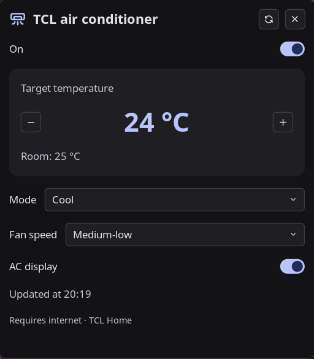

# TCL Home AC for Noctalia

Control a **TCL Home split air conditioner** from the Noctalia control center or
bar, without Alexa or Home Assistant.

[Português brasileiro](README.pt-BR.md) · [Security](SECURITY.md) · [MIT license](LICENSE)



## Features

- Power, target temperature (16–30 °C), mode, fan speed and AC display controls.
- Room temperature and reported device state.
- Responsive temperature preview: rapid +/− clicks are grouped into one command
  **800 ms after the last click**, instead of one cloud request per degree.
- Pending commands stay separate from device-confirmed state.
- A control-center shortcut, a popup panel, and an optional bar widget.
- English and Portuguese interface.
- Noctalia starts/stops the companion; no separate system service is required.

**Requires internet and the unofficial TCL Home cloud API (TCL/AWS). This is not
local/LAN control.** Being on the same Wi-Fi is not enough. Vendor API changes can
break the integration. Nothing is switched on just by opening the panel.

## Compatibility

Tested by the author on **TCL TAC-12CHTG2-INV**, firmware
`V8-R82CT20-WFMV205.11.3.28`, paired through **TCL Home**, on CachyOS/Hyprland
with **Noctalia 5.3.0**. Both reading and controls were confirmed by the author.
Other TCL models, firmware versions, regions, apps and HVAC protocols are **not
guaranteed** to work. Current version requires **exactly one AC** in the account;
share only the intended device with a dedicated integration account.

- Noctalia **5.0.0-beta.9 or later** (plugin API 24; tested on 5.3.0).
- Linux, Python **3.11+**, `venv`/pip, and Git.
- A TCL Home account with a password; social login alone is not sufficient.
- On Arch/CachyOS: `sudo pacman -S --needed python git`.
- On Debian/Ubuntu: install `python3`, `python3-venv`, and `git` first.

## Install

### 1. Set up the companion and credentials

Review the code before running it. In a terminal:

```sh
git clone https://github.com/ggmorais/noctalia-tcl-control.git
sh noctalia-tcl-control/tcl-control/setup.sh
```

The setup installs boto3 in an **isolated user-owned virtual environment** and
asks for your TCL Home username/password with hidden password input. It does not
change system Python, require root, or send commands to the AC. Existing
credentials are never overwritten.

Credentials are plaintext with mode `600`, outside the repository:

```text
${XDG_CONFIG_HOME:-~/.config}/tcl-control/credentials.env
```

The virtual environment is stored outside the plugin's update directory:

```text
${XDG_DATA_HOME:-~/.local/share}/tcl-control/venv
```

Use a **separate TCL Home account** and share your AC with it from the original
account. The temporary sharing QR code is an invitation for that account, **not**
a replacement for login credentials. Never paste credentials into an issue.

### 2. Add this plugin source and enable it

```sh
noctalia msg plugins source add tcl-home git https://github.com/ggmorais/noctalia-tcl-control.git
noctalia msg plugins enable ggmorais/tcl-control
```

This repository has its own `catalog.toml`. It is **not yet part of the official
or community catalog**; adding the source makes it available in your plugin list.

### 3. Add a shortcut or bar widget

In **Noctalia Settings → Control Center**, add the **TCL Home AC** shortcut.
Noctalia currently displays at most six Home shortcuts; replace an existing one
if needed. Clicking it opens the controls, not a power toggle.

Equivalent shortcut configuration (add to your existing shortcut list):

```toml
[[control_center.shortcuts]]
type = "ggmorais/tcl-control:ac"
```

If you prefer the bar, add this plugin's **bar** widget in Noctalia's bar editor,
or define an instance and include `tcl_ac` in your existing bar's start/center/end:

```toml
[widget.tcl_ac]
type = "ggmorais/tcl-control:bar"
```

Open the panel directly:

```sh
noctalia msg panel-open ggmorais/tcl-control:controls
```

## How it works / limitations

The companion authenticates with TCL Home and obtains temporary AWS credentials.
It reads the AC's AWS IoT device shadow and publishes only allowlisted changes
after an explicit user action. Auth tokens are **memory-only**. State is polled
every 60 seconds, with a follow-up after 3 seconds for a command. A refresh button
is available. Credentials are reloaded when the session renews (10 minutes).

Temperature changes are previewed locally while clicking. You can keep adjusting
while a temperature request is in flight; only the latest queued target is sent
next, with no concurrent requests. Closing the panel sends any remaining chosen
temperature immediately (or after the active request finishes). Exiting/reloading
the plugin cancels an unsent draft. A failed request cancels queued edits rather
than silently retrying. The other controls are not debounced.

- Cloud acceptance is **not physical-device confirmation**. Offline devices,
  stale shadows, API errors and network delays can leave a command pending.
- Mode and fan mappings follow the reference integration's split-AC protocol.
  Heat mode may not be supported by a cooling-only model. Unknown controls are
  rejected rather than sent as arbitrary JSON.
- Temperature is Celsius only, conservatively limited to 16–30 °C.
- No scheduling, multi-device selection, Matter, IR, or LAN protocol support.
- Some diagnostic/error messages from the companion are currently Portuguese.
- Plugins run as your desktop user. Treat this and any other plugin as trusted
  code; local file permissions are **not encryption or a sandbox**.

## Updates / troubleshooting

Update the plugin with Noctalia's plugin manager. After an update that changes
Python requirements, pull this checkout and rerun `setup.sh`; it preserves your
credential file. Disable/re-enable the plugin after setup or credential changes.

For read-only diagnostics (no AC commands):

```sh
"${XDG_DATA_HOME:-$HOME/.local/share}/tcl-control/venv/bin/python" \
  noctalia-tcl-control/tcl-control/backend/status.py --env
```

If credentials are refused for permissions, use `chmod 600` on the credentials
file. Set `TCL_ENV_FILE` only when intentionally using a different private file.
The companion also accepts `TCL_LOGIN`/`TCL_PASSWORD` from its environment, but
those are not automatically imported from a terminal into a running desktop.

Disable:

```sh
noctalia msg plugins disable ggmorais/tcl-control
```

Then remove the shortcut/bar widget in settings. Noctalia stops the companion.
Credentials and the virtual environment are intentionally retained; remove those
specific user-owned paths manually if you no longer want them. No changes are
made to the AC when disabling the plugin.

## Development

```sh
python3 -m venv .venv
.venv/bin/python -m pip install -r tcl-control/backend/requirements.txt
.venv/bin/python -m unittest discover -s tcl-control/backend -v
.venv/bin/python -m unittest discover -s tests -v
lua tests/test_panel.lua
noctalia plugins lint tcl-control
```

Tests use simulated API responses, including real boto3 clients with botocore
Stubber. They require no TCL account and send no device commands. GitHub Actions
runs the Python tests, package checks and panel behavior tests (Lua 5.4+).
The panel uses the common Lua/Luau subset; its behavior tests execute the actual
script against a fake Noctalia host, clock and cloud. Integration changes should first be
tested with read-only queries.

## Credits

TCL Home protocol research and adapted portions:
[András Nemes's Home Assistant integration](https://github.com/nemesa/ha-tcl-home-unofficial-integration),
MIT licensed. See [NOTICE](NOTICE). This project is unaffiliated with TCL, Amazon,
or Noctalia.
